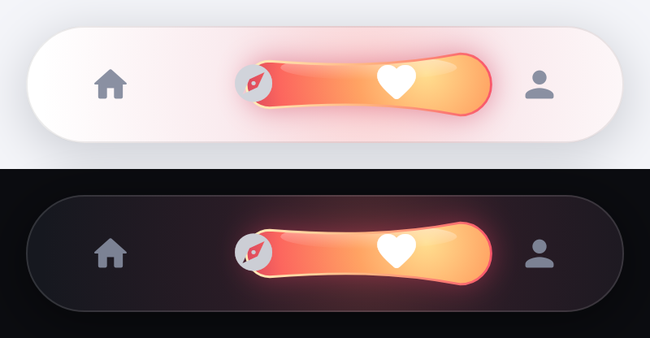
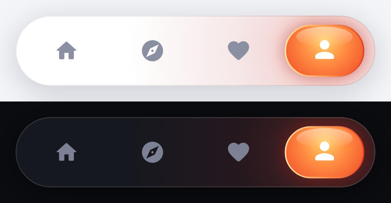

# fluid_bottom_bar

A Flutter bottom navigation bar with a **liquid selection indicator**. The
blob moves between tabs on spring physics, stretching and wobbling as it goes,
and blends each tab's gradient palette across the bar. It's inspired by
[hyperiontechllc/fluid-bottom-bar](https://github.com/hyperiontechllc/fluid-bottom-bar)
(Compose Multiplatform).

| Moving | Settled |
| --- | --- |
|  |  |

## Features

- A liquid blob driven by two springs. The leading end is snappy and the
  trailing end is softer, so the blob stretches, thins (keeping its volume
  roughly constant), pinches at the waist and wobbles into place.
- Per-tab `FluidPalette`s (4-layer fill + 3-stop outline) that blend while the blob travels.
- Drag to select: press the bar and drag the blob, then release or flick it
  onto a tab. The ends resist overscroll and each tab crossing gives a haptic click.
- Light and dark colors that follow the ambient `Theme`.
- Accessibility: each tab is a semantic button with a label and selected state.
- Pure Flutter (`CustomPainter` + `Ticker`), no dependencies.

## Usage

```dart
import 'package:fluid_bottom_bar/fluid_bottom_bar.dart';

int selected = 0;

Scaffold(
  extendBody: true,
  bottomNavigationBar: SafeArea(
    minimum: const EdgeInsets.fromLTRB(20, 0, 20, 12),
    child: FluidBottomBar(
      selectedIndex: selected,
      onItemSelected: (i) => setState(() => selected = i),
      items: const [
        FluidBarItem(icon: Icon(Icons.home_rounded), label: 'Home', palette: FluidPalettes.aurora),
        FluidBarItem(icon: Icon(Icons.explore_rounded), label: 'Explore', palette: FluidPalettes.orchid),
        FluidBarItem(icon: Icon(Icons.favorite_rounded), label: 'Favorites', palette: FluidPalettes.sunset),
        FluidBarItem(icon: Icon(Icons.person_rounded), label: 'Profile', palette: FluidPalettes.ember),
      ],
    ),
  ),
);
```

`FluidBottomBar` is controlled. It reports taps and drops through
`onItemSelected` and animates whenever `selectedIndex` changes.

### Parameters

| Parameter | Default | Description |
| --- | --- | --- |
| `items` | required | `FluidBarItem`s (at least one) |
| `selectedIndex` | required | Selected tab |
| `onItemSelected` | required | Called with the tapped / dropped tab |
| `colors` | `FluidBottomBarColors.of(context)` | Surface, border, shadow and icon colors |
| `height` | `72` | Bar height |
| `horizontalPadding` | `8` | Inset of the outer tabs |
| `verticalInset` | `10` | Gap between the bar edge and the blob |
| `borderRadius` | `height / 2` | Bar corner radius |
| `iconSize` | `26` | Icon size |
| `enableDrag` | `true` | Allow dragging the blob |
| `enableHaptics` | `true` | Selection click while dragging across tabs |

### Custom palettes

```dart
const mint = FluidPalette(
  fillCore: Color(0xFFE0FFF4),
  fillMiddle: Color(0xFF7AF0C5),
  fillOuter: Color(0xFF2CC99A),
  fillEdge: Color(0xFF12806A),
  strokeStart: Color(0xFFF0FFF9),
  strokeMiddle: Color(0xFF9CF5D6),
  strokeEnd: Color(0xFF1FA387),
);
```

Built-in palettes: `FluidPalettes.aurora`, `orchid`, `sunset`, `ember`.

## Example

```sh
cd example
flutter create . --platforms=android,ios   # generate platform folders once
flutter run
```

## Tests

```sh
flutter test
```
